# EcoMobility: Final App Design

This is the design spec for the EcoMobility mobile app (iOS and Android, Expo / React Native). It covers all 9 main screens in light and dark mode.

The final design is **Wayfinder** (Design D). Wallet, Support and Account use the layouts from **Coral Clarity** (Design A), drawn in Wayfinder's type, colours and components.

> **This is a design, not code.** Nothing in the app has been changed yet. All names, prices, stations and numbers in the pictures are sample data.
>
> Some functions shown here don't work yet. Their designs stay, and they're tracked in the [Feature Agenda](FEATURE_AGENDA.md).

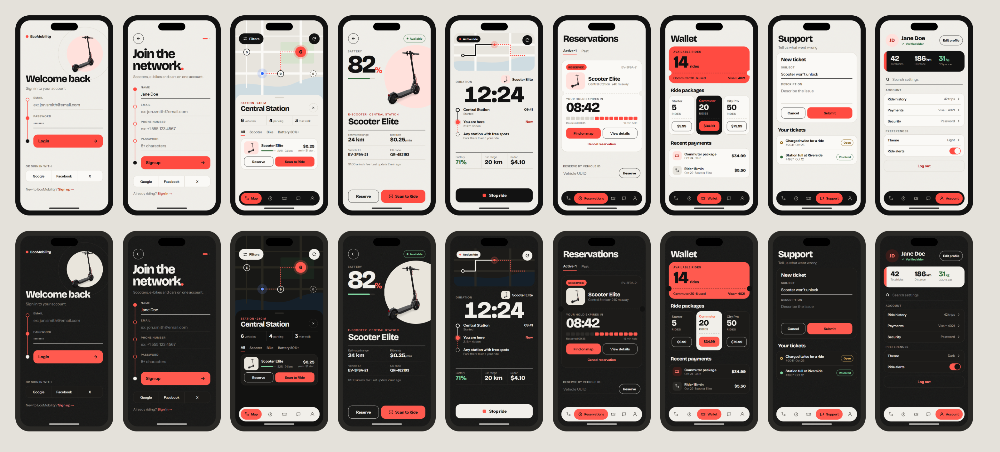

## Contents

1. [The idea](#1-the-idea)
2. [Design system](#2-design-system)
3. [Components](#3-components)
4. [Screens](#4-screens)
5. [What developers need to know](#5-what-developers-need-to-know)
6. [Not designed yet](#6-not-designed-yet)
7. [Open decisions](#7-open-decisions)
8. [Ticket to add: Support categories](#8-ticket-to-add-support-categories)

---

## 1. The idea

EcoMobility helps people move around a city, so the design borrows from transit signage: maps, route lines, stops, tickets and passes.

| Principle | What it means in practice |
|---|---|
| **Route line** | A line with stops is the recurring motif. Sign-in fields are stops on a coral line, with Login as the last stop. The active ride is shown as start, current position and end. |
| **Tickets** | Things you hold or buy look like tickets, with a dashed tear line and notches: reservations, the ride balance and packages. |
| **One signal colour** | Coral marks the one thing to act on next. It isn't used as decoration. |
| **Numbers first** | The number you care about is the largest thing on the screen: battery, ride timer, hold countdown, rides left. |
| **Lines over boxes** | Thin dividers organise information, so cards aren't stacked inside cards. |
| **Same layout in both themes** | Dark mode changes colour values only. No screen is laid out differently. |

---

## 2. Design system

### 2.1 Colour

Roughly 60% neutral background, 30% ink and 10% coral.

| Token | Use | Light | Dark |
|---|---|---|---|
| `bg` | Screen background | `#F1EFEA` | `#121211` |
| `surface` | Cards, sheets | `#FAF9F6` | `#1C1B19` |
| `text` | Main text, outlined button borders | `#121212` | `#F1EFEA` |
| `muted` | Labels, secondary text | `#5E5B55` | `#A39F97` |
| `line` | Dividers, card borders | `#D9D5CC` | `#2E2C29` |
| `accent` | Main button, active tab, selected marker | `#FF4B41` | `#FF5A4F` |
| `accentText` | Coral text on background (links, Log out) | `#B8291F` | `#FF7A70` |
| `onAccent` | Text on coral | `#121212` | `#121212` |
| `inverse` | Tab bar, Stop ride, highlighted cards | `#121212` | `#F1EFEA` |
| `inverseText` | Text on `inverse` | `#F1EFEA` | `#121211` |
| `inverseMuted` | Inactive icons on `inverse` | `#A39F97` | `#5E5B55` |
| `success` | Battery, Available, Resolved | `#2F6B3A` | `#7FD6A0` |
| `warning` | Open ticket | `#8A5A00` | `#F2C26B` |
| `accentSoft` | Avatar, payment icon tile | `#FFE1DC` | `#3A1C19` |
| `photoTile` | Light surface behind vehicle photos | `#FFE1DC` | `#E9E5DC` |
| `location` | Your location on the map | `#2F6BFF` | `#6E97FF` |

**Map colours**

| Token | Light | Dark |
|---|---|---|
| `mapLand` | `#E7E4DD` | `#181816` |
| `mapRoad` | `#FAF9F6` | `#28261F` |
| `mapPark` | `#D8E2CE` | `#1B241C` |
| `mapWater` | `#CFDCE1` | `#15202A` |

The dark Active ride map card is slightly lighter: land `#1C1B19`, road `#2A2823`.

**Coral rule:** text on coral is always near-black, never white. White on `#FF4B41` is only about 3:1, which is too low. Near-black passes at 5.7:1.

**Measured contrast**

| Pair | Light | Dark | Minimum |
|---|---|---|---|
| `text` on `bg` | 16.3:1 | 16.3:1 | 4.5:1 |
| `muted` on `bg` | 5.9:1 | 7.1:1 | 4.5:1 |
| `muted` on `surface` | 6.4:1 | 6.5:1 | 4.5:1 |
| `onAccent` on `accent` | 5.7:1 | 6.1:1 | 4.5:1 |
| `accentText` on `bg` | 5.4:1 | 7.4:1 | 4.5:1 |
| `success` on `surface` | 6.1:1 | 9.9:1 | 4.5:1 |
| `warning` on `surface` | 5.6:1 | 10.4:1 | 4.5:1 |
| `inverseMuted` on `inverse` | 7.1:1 | 5.9:1 | 3:1 (icons) |

### 2.2 Typography

Two typefaces, both free on Google Fonts:

- **Bricolage Grotesque** for headlines and large numbers.
- **Instrument Sans** for everything else.

| Style | Font | Size | Weight | Letter spacing | Used for |
|---|---|---|---|---|---|
| Hero number | Bricolage | 112–136 | 800 | −5 to −7 | Battery, ride balance |
| Ride timer | Bricolage | 104 | 800 | 0 | Active ride, centred |
| Page hero | Bricolage | 58 | 800 | −2.5 | "Join the network." |
| Countdown | Bricolage | 60–76 | 800 | −2.5 to −3 | Hold timer, Wallet balance |
| Page title | Bricolage | 42–44 | 800 | −1.8 | Reservations, Wallet, Support, Welcome back |
| Detail title | Bricolage | 32–40 | 800 | −1.2 to −1.6 | Central Station, Scooter Elite |
| Section title | Bricolage | 22 | 800 | −0.6 | Ride packages, Your tickets |
| Stat value | Bricolage | 22–32 | 800 | −1 | Stats, prices |
| Input | Instrument | 17–18 | 500 | 0 | Field text |
| Button | Instrument | 15–18 | 700 | 0 | All buttons |
| Body | Instrument | 15–16 | 500–700 | 0 | List titles |
| Secondary | Instrument | 13–14 | 400–500 | 0 | Sub-lines |
| Label | Instrument | 12 | 600 | 1.2–1.4 | Uppercase labels |

Timers use tabular numbers so the digits don't jump as they count.

### 2.3 Layout

- **Base screen:** 390 × 844. All values here are in dp.
- **Spacing:** multiples of 4 (mostly 8, 12, 16, 24).
- **Screen margins:** 24 for text, 16 for cards, so cards sit slightly wider than the text.
- **Touch targets:** at least 44 × 44.
- **Tab bar clearance:** content ends above y = 758, where the tab bar starts.

| Radius | Used for |
|---|---|
| 13–16 | Status pills, small buttons |
| 18–20 | Main buttons, list cards |
| 22–28 | Vehicle, ticket and balance cards |
| 32 | Bottom sheet, tab bar |
| Full | Icon buttons, markers, avatar |

### 2.4 Texture and icons

- **Paper grain:** a very faint noise layer behind the content, at 7% opacity in light and 10% in dark. It's optional, and a small tiled PNG is enough. It isn't used on the Map screen.
- **Icons:** 2–2.2 stroke, rounded ends. Tab icons are custom: route (Map), stopwatch (Reservations), ticket (Wallet), speech bubble (Support), person (Account).

---

## 3. Components

### Tab bar

Floating pill, 64 high, radius 32, 16 from each edge and 22 from the bottom, using the `inverse` colour. The active tab is a coral pill (48 high) with icon and label, and inactive tabs are icons only. In dark mode the bar is cream, so it stands out against the screen.

### Buttons

| Type | Style | Example |
|---|---|---|
| Primary | Coral fill, near-black text | Login, Scan to Ride, Submit |
| Secondary | Transparent, 1.5 `text` border | Reserve, Cancel |
| Inverse | `inverse` fill | Stop ride |
| Text | No background, `accentText` colour | Cancel reservation |
| Icon | Circle, 44–48 | Back, close, refresh |

Only one primary button appears per area.

### Map controls

Filters is an `inverse` pill, 48 high, with an icon and label, top-left over the map. It shows a small coral dot when a map filter is on, as the app does today. Refresh is a 48 `inverse` circle, top-right. Both sit below the status area.

### Photo tile

The vehicle photos are dark, so they always sit on `photoTile`, in both themes: a large circle on Sign in and Vehicle details, and a rounded tile on Map, Active ride and Reservations. This keeps them readable in dark mode.

### Inputs

No box. An uppercase 12 label sits above the text, with a bottom line: `line` when idle, `text` at 2 thick when focused.

### Route line

A 2-wide coral vertical line with 16 stops, 18 from the content. An empty ring is a stop not reached, a filled dot is the current one, and a solid `text` dot is the end. On Active ride the line is solid behind you and dashed ahead.

### Ticket

Card with a dashed tear line, and 24 circular notches in the screen background colour at each end of the line.

### Status pill

26 high, 1.5 border and text in the same status colour: `warning` for Open, `success` for Resolved. Coral-filled for Reserved.

### Map markers

| Marker | Style |
|---|---|
| Selected station | 48 coral circle, near-black number, soft halo |
| Station | 30 circle, 2.5 `text` border, vehicle count |
| Empty station | 30 circle, dashed `muted` border, shown only if Show Empty Stations is on |
| You | Blue dot with soft ring |

### Step indicator

Coral pill (22 × 6) and grey dot (6 × 6). See [Open decisions](#7-open-decisions).

---

## 4. Screens

### 1. Sign in

| Light | Dark |
|---|---|
| 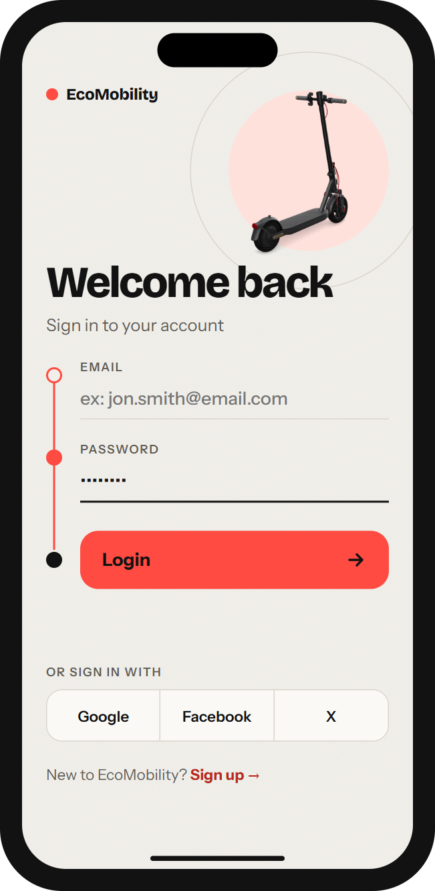 | 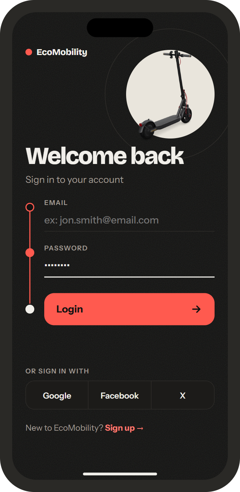 |

**Layout:** wordmark top-left. Scooter top-right on a soft circle with a thin ring. "Welcome back" (44) and "Sign in to your account" below. The form runs down a route line: Email, Password, Login as the end stop. Social buttons are one segmented row, followed by the Sign up link.

**Keeps:** email, password, Login, Google / Facebook / X, Sign up link, error alerts.

**Code:** `app/sign-in.tsx`

### 2. Sign up

| Light | Dark |
|---|---|
| 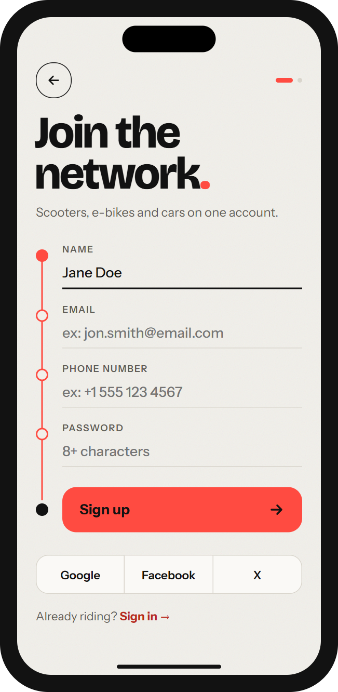 | 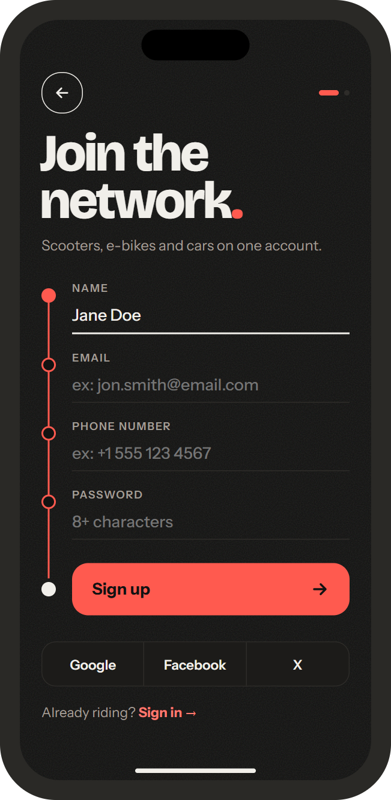 |

**Layout:** back button and step indicator on top. "Join the network." (58) with a coral full stop. Four fields on the route line, then Sign up as the end stop.

**Keeps:** Name, Email, Phone number, Password, Sign up, socials, Sign in link, back.

**Code:** `app/sign-up.tsx`

### 3. Map and station

| Light | Dark |
|---|---|
| 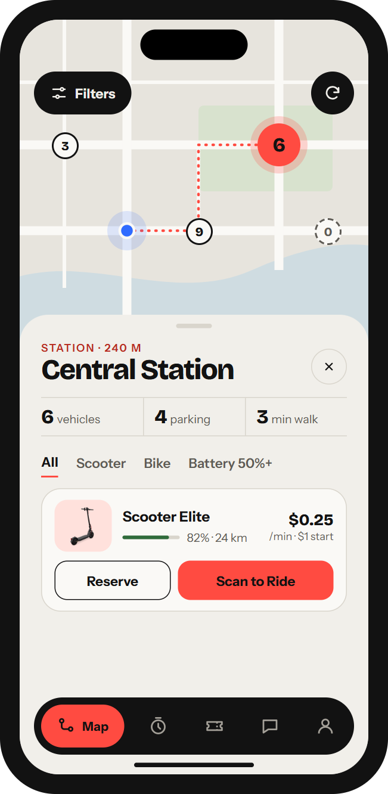 | 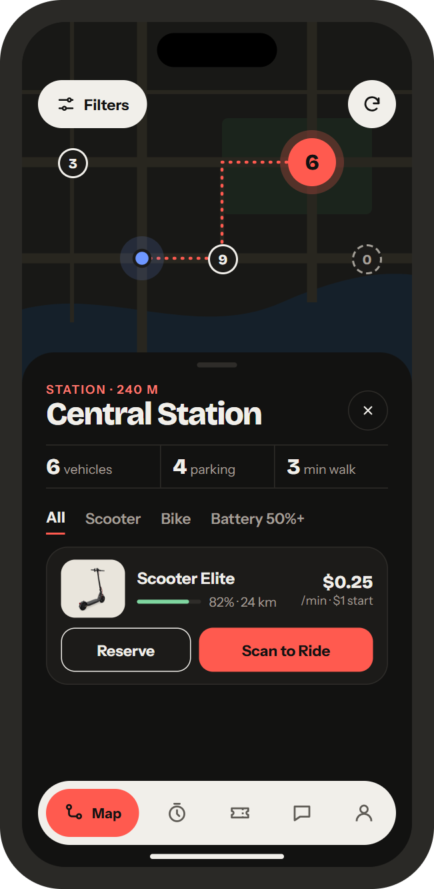 |

**Layout:** map fills the top. Filters and Refresh float over it, in the same two positions as the app's current controls. The station sheet starts at y = 330 and contains:

1. Distance label and station name.
2. Three stats in one divided row: vehicles, parking, walk time.
3. Filter tabs: All, Scooter, Bike, Battery 50%+.
4. Vehicle card: photo, battery bar, range, rate, Reserve and Scan to Ride.

**Keeps:** markers, station details, vehicle filters, Map Filters, Refresh map, Reserve, Scan to Ride.

**Code:** `app/(tabs)/map.tsx`, `map.web.tsx`, `components/station-details-panel.tsx`, `station-vehicle-card.tsx`, `vehicle-filters-panel.tsx`, `map-stations-filter-sheet.tsx`, `osm-leaflet-html.ts`

**Note:** the map needs dark tiles or a dark style in Leaflet for the dark theme to match.

### 4. Vehicle details

| Light | Dark |
|---|---|
| 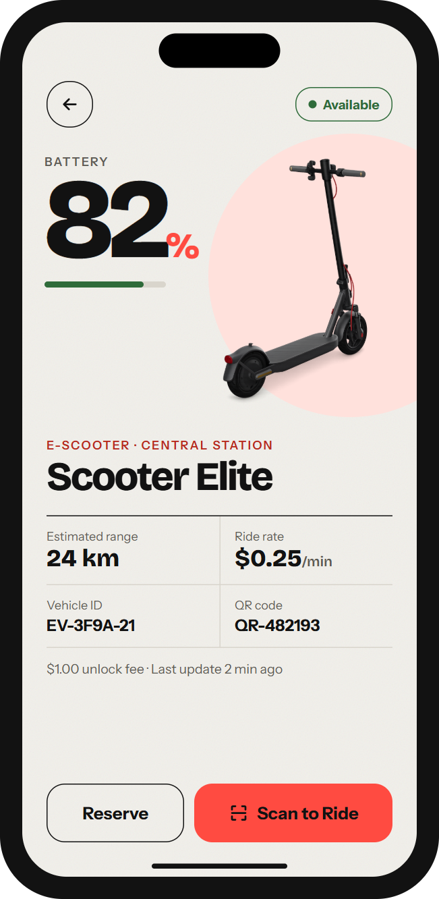 | 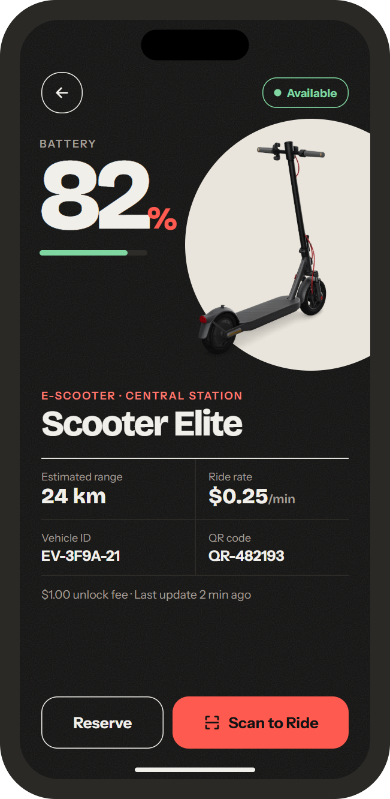 |

**Layout:** battery is the hero at 112, with a thin bar beneath it. The vehicle photo overlaps from the right. Below are the type, the name, then a 2 × 2 grid of range, rate, vehicle ID and QR code. Unlock fee and last update sit on one line. Reserve and Scan to Ride are fixed at the bottom.

**Keeps:** status, battery, estimated range, ride rate, vehicle ID, QR code, last update, Reserve, Scan to Ride.

**Must also handle:** Reserved by you, Reserved by another rider, In use, Maintenance, Unavailable, Vehicle not found, and the low battery warning. The status pill changes, and the buttons disable where needed.

**Code:** `app/vehicle/[id].tsx`

### 5. Active ride

| Light | Dark |
|---|---|
| 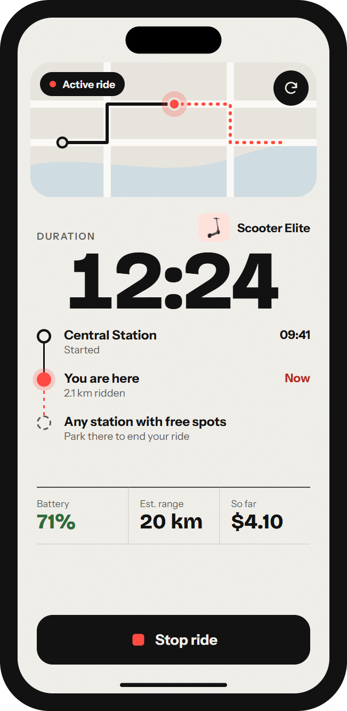 | 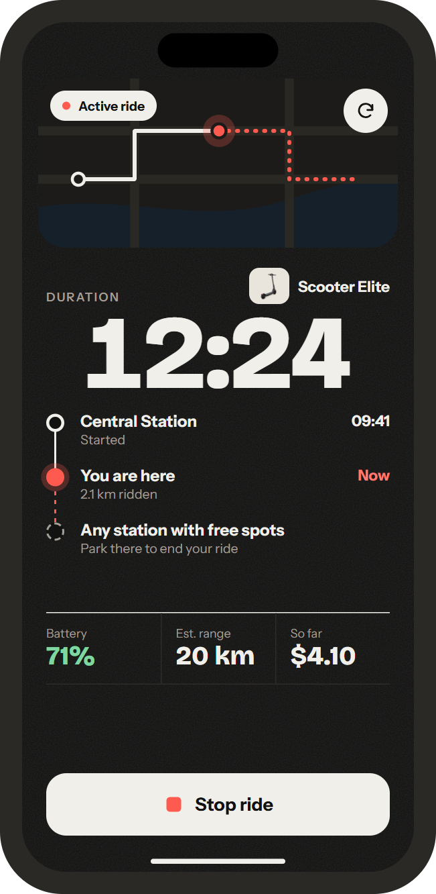 |

**Layout:** small map card with an "Active ride" pill and Refresh. Centred timer at 104. Route line: start station, You are here, any station with free spots. Battery, range and cost in a divided row. Stop ride in `inverse` at the bottom, on purpose: it should be easy to find but not look like a casual action.

**Keeps:** duration, battery, estimated range, Refresh map, Stop ride.

**Adds:** start station and time, distance ridden, cost so far. See [section 5](#5-what-developers-need-to-know).

**Code:** `components/active-ride-bottom-card.tsx`, `app/(tabs)/map.tsx`

**Note:** the app shows a ride as a small card floating over the full map today, with the tab bar in place. This design is a full screen with a small map and no tab bar, so it's a layout change, not only a restyle. See [Open decisions](#7-open-decisions).

### 6. Reservations

| Light | Dark |
|---|---|
| 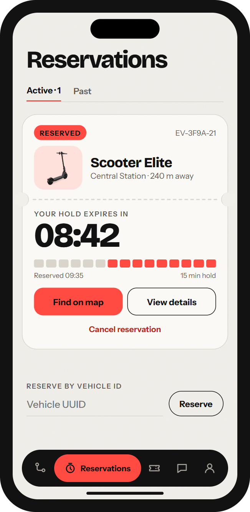 | 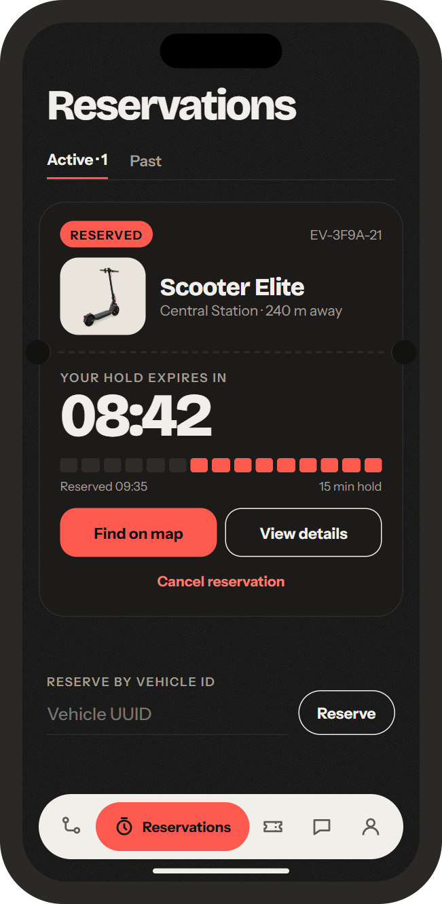 |

**Layout:** title and Active / Past tabs. The hold is a ticket: vehicle above the tear line, countdown below it. The 15 segments are one per minute of the default 15-minute hold (`DEFAULT_RESERVATION_TTL_MINUTES`), and used minutes turn grey. Reserve by vehicle ID sits below.

**Keeps:** Find on map, View details, Cancel reservation with confirm, Reserve by vehicle ID.

**Must also handle:** Remove reservation on past items, empty state.

**Code:** `app/(tabs)/reservations.tsx`

**Note:** the backend allows holds of 1–60 minutes. If that length ever varies, use a smooth progress bar instead of fixed segments.

### 7. Wallet (A's layout in D's style)

| Light | Dark |
|---|---|
| 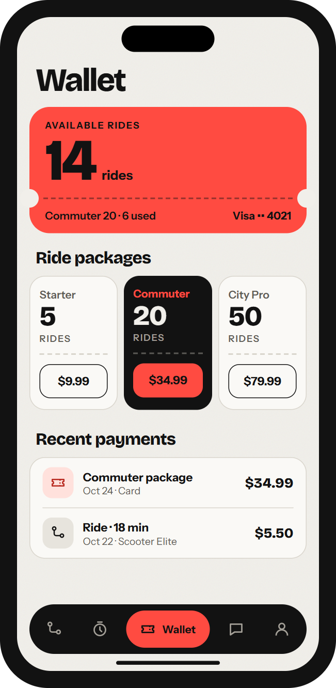 | 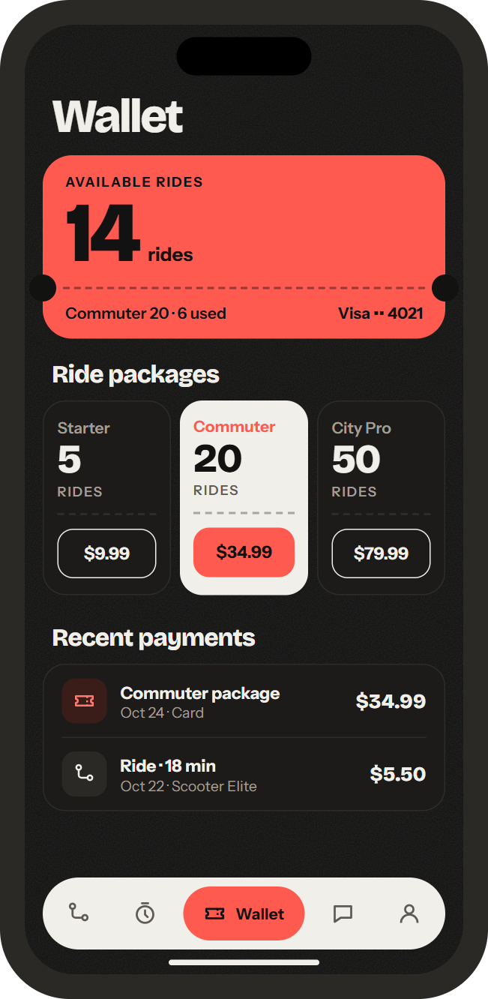 |

**Layout:** coral balance card with the rides left at 76, tear line, then current package and card. Three package cards side by side, with the best one in `inverse`. Recent payments is a short list with icon tiles.

**Keeps:** available rides, packages and purchase, default card, payment history, empty states ("No packages available yet.", "No payment history.", "No purchases yet.").

**Must also handle:** the Payment methods action. Make the card name on the balance card tappable.

**Code:** `app/(tabs)/wallet.tsx`

### 8. Support (A's layout in D's style)

| Light | Dark |
|---|---|
| 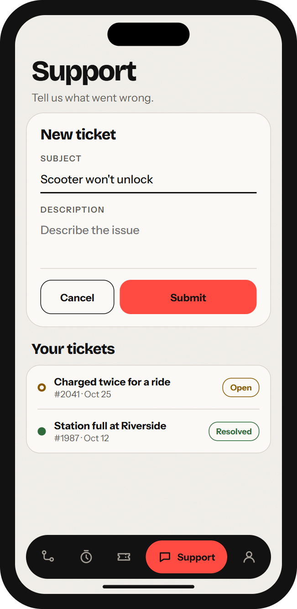 | 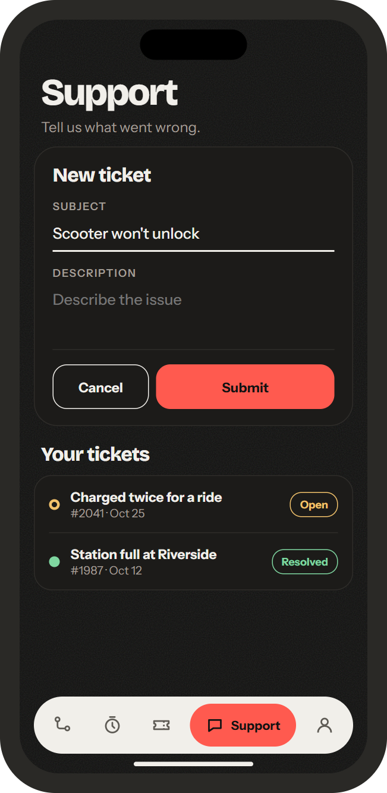 |

**This is the design to build now.** The form has only Subject and Description. A later version with categories is in [section 8](#8-ticket-to-add-support-categories).

**Layout:** title and a short line. New ticket card on the screen, with Cancel and Submit. Your tickets list below, with a status dot and pill.

**Keeps:** Subject, Description, Submit, Cancel, ticket list, statuses, "Missing info" and "Could not create ticket" alerts.

**Code:** `app/(tabs)/support.tsx`

**Note:** the app opens the form with a New ticket button today. This design always shows the form. If the ticket list gets long, keep the current button instead.

### 9. Account (A's layout in D's style)

| Light | Dark |
|---|---|
| 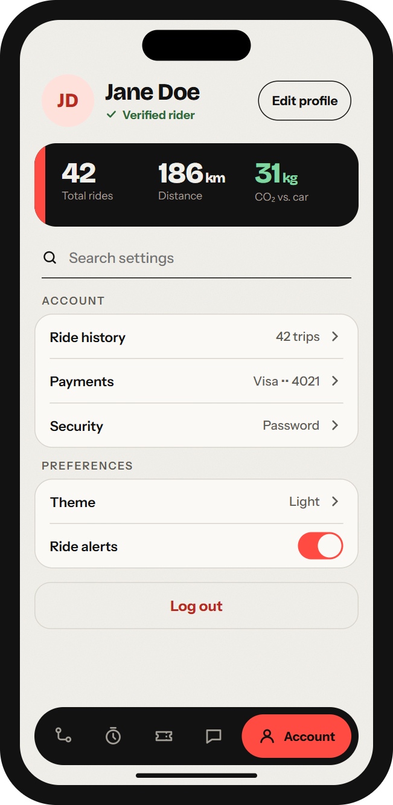 | 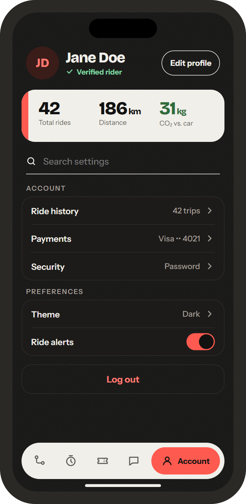 |

**Layout:** avatar, name, Verified rider and Edit profile. Stats card in `inverse` with a coral stripe. Search settings underneath. Grouped Account and Preferences lists. Log out at the bottom.

**Keeps:** Edit profile, stats, search, Theme, Log out.

**The picture shows only part of the list.** The screen scrolls, and everything else stays in the same grouped-list style: Language, Security, Change password, Identity verification, Emergency contact, Promo codes, Billing history, Safety tips, Help, About, Privacy, Terms, Delete account, Quick Actions and Recent Activity.

The other stats (Total time, Favorite type, Active holds) can go in a second row or a swipeable stats card.

**Code:** `app/(tabs)/account.tsx`, `components/account/*`

---

## 5. What developers need to know

### Fonts

The fonts aren't in the project yet. `expo-font` is installed, so add:

```bash
npx expo install @expo-google-fonts/bricolage-grotesque @expo-google-fonts/instrument-sans
```

### Theme

- Put the tokens in `constants/theme.ts` and replace `accountSurfaces` in `components/account/account-theme.ts`.
- The current accent `#FF4B41` stays in light mode.
- The Theme setting already exists in preferences, so it should drive the new tokens.

### Tab bar

Restyle `components/pill-tab-bar.tsx`. The navigation structure stays the same.

### New data the design needs

| Item | Screen | How to get it |
|---|---|---|
| Walk time | Map | Estimate from distance (`lib/geo-distance.ts`) |
| Cost so far | Active ride | `initial_fee + elapsed minutes × price_per_minute`, shown as an estimate. The final cost still comes from the backend. |
| Distance ridden | Active ride | **Not available today.** The design keeps it, and it's on the [Feature Agenda](FEATURE_AGENDA.md#1-money-and-wrong-numbers). |
| Start station name | Active ride | Needs a lookup from the ride's start point or start station |
| Hold start time | Reservations | Use the reservation's `created_at` |

### Accessibility

- Add labels to icon-only buttons.
- Status must never rely on colour alone. Pills always include text.
- Respect the system text size. Large numbers can scale less than body text.

---

## 6. Not designed yet

These exist in the app and still need screens in this style:

- Scan to Ride camera (`components/scan-to-ride-modal.tsx`)
- Ride complete receipt (`components/ride-end-receipt-modal.tsx`)
- Map Filters sheet (`components/map-stations-filter-sheet.tsx`)
- Sign out confirmation (`components/account/sign-out-confirm-modal.tsx`)
- Language and Theme picker (`components/account/preference-picker-modal.tsx`)
- Loading skeletons (`components/screen-skeletons.tsx`) and offline banner (`components/offline-banner.tsx`)
- Empty, error and permission states

---

## 7. Open decisions

| # | Decision | Why it matters |
|---|---|---|
| 1 | **Rides or minutes in the Wallet** | Rides are charged by the minute (`backend/app/services/pricing.py`), but packages sell ride credits. Nothing reduces `rides_remaining` when a ride ends, so the two aren't connected. The team needs to choose minute bundles, ride passes or a money balance. The design shows "rides" for now, matching the current code. |
| 2 | **Sign-up step indicator** | The design shows two steps, but sign-up is one form. Remove the indicator, or add a real second step such as phone verification. |
| 3 | **Active ride layout** | Moving from a card over the full map to a full screen means less map while riding, and it needs a tab bar decision. Build the full screen, or keep the card over the map and apply only the new style. |

---

## 8. Ticket to add: Support categories

**Not part of the first build.** Copy the text below into a new GitHub issue so this isn't forgotten, and attach the two pictures from `docs/design/screens/future/`.

| Light | Dark |
|---|---|
| 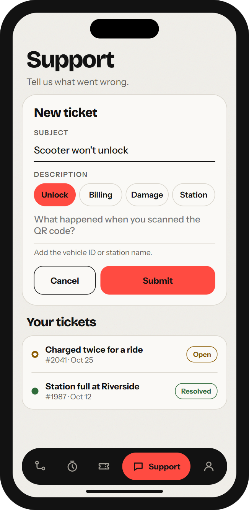 | 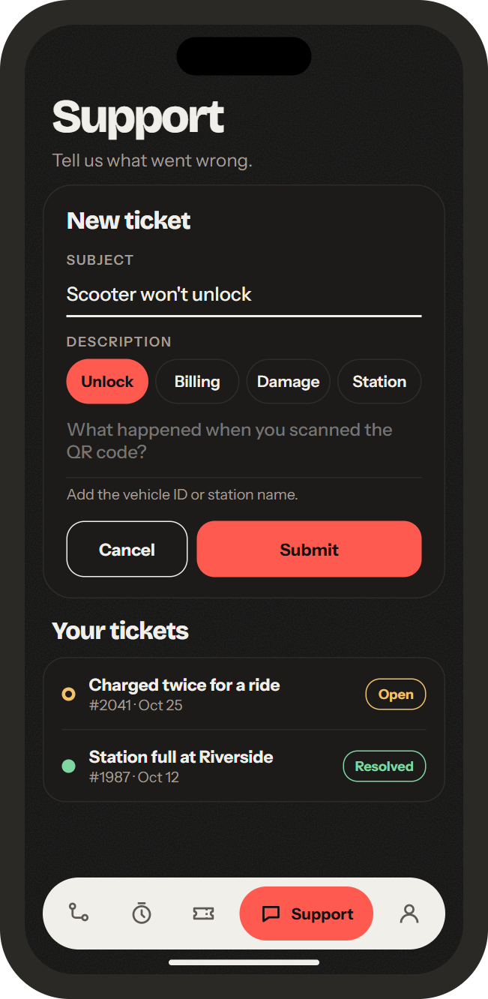 |

````markdown
# Add categories and guidance to the Support ticket form

## Why
The Description field is empty and gives no guidance, so riders may leave out details
such as the vehicle or station. Support then has to ask follow-up questions.

## What to build
In the New ticket form on the Support screen, under the Description label:

1. **Category chips:** Unlock, Billing, Damage, Station.
   - Pick one at a time.
   - Selected chip: coral fill. Others: outlined.
   - 40 high, full radius, evenly spaced on one row.
2. **A prompt for each category,** shown as the placeholder:
   - Unlock: "What happened when you scanned the QR code?"
   - Billing: "Which ride or payment is wrong, and by how much?"
   - Damage: "What is damaged, and on which vehicle?"
   - Station: "Which station, and what is wrong there?"
3. **Helper line** under the box: "Add the vehicle ID or station name."

## Backend
Tickets only store `subject`, `description`, `status` and `created_at`
(`backend/app/routers/support.py`), so there is no category field yet.

- **Option A, no backend change:** add the category to the subject,
  e.g. "Unlock: Scooter won't unlock".
- **Option B, recommended:** add a `category` column with a migration,
  accept it in the create-ticket request, and show it in the ticket list.

## Done when
- [ ] A rider can pick a category before submitting
- [ ] The prompt changes with the category
- [ ] The category is saved with the ticket
- [ ] It works in light and dark mode
- [ ] Layout fits on small phones without overlapping Your tickets
- [ ] Submitting without a category still works, unless the team decides it is required

## Files
- `electric-micro-mobility/app/(tabs)/support.tsx`
- `backend/app/routers/support.py`
- `backend/app/schemas.py`
- `backend/migrations/` (Option B only)
````
